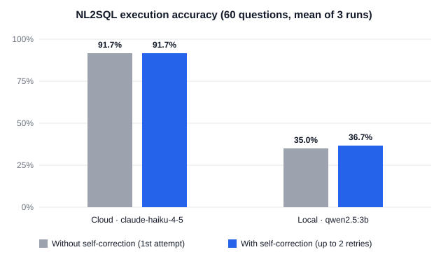

# geo-nl2sql-agent

[](https://github.com/Rocky1987/geo-nl2sql-agent/actions/workflows/ci.yml)

**中文** | [English](#english)

以 .NET 與 Microsoft Agent Framework 打造的「自然語言轉 SQL」空間資料代理，後端為 SQL Server，Web 層採用 ASP.NET Core MVC。
這是個人作品集專案：所有資料皆為合成資料，不涉及任何真實客戶或公司。

## 技術亮點

模型產生的 SQL 不被信任，由兩道彼此獨立的防線把關：

1. **SQL AST 白名單**：以 ScriptDom 解析，只放行單一 `SELECT`，資料表與函式都限白名單；任何解析錯誤、多語句、`SELECT INTO`、動態 SQL、外部資料來源都拒絕。
2. **唯讀資料庫登入**：生成的 SQL 只用 `geo_reader` 執行，資料庫層只授予 `SELECT`，即使第一層被繞過也無法寫入或改結構。

另有逾時與列數上限、有界的自我修正（最多 2 次），以及只回饋固定訊息、不把資料庫原文交給模型的錯誤消毒。60 條攻擊語料庫的結果與兩層的分工見 [docs/feasibility-report.md](docs/feasibility-report.md) §8。

個資、稽核與提示詞注入：

- **模型永遠看不到原始個資。** 客戶的姓名、身分證字號、電話、電子郵件在資料庫層對模型用的登入 `DENY`，模型只能讀到遮蔽後的檢視（例如 `A*******21`）。頁面可選 `analyst`／`admin` 角色：admin 的表格會換成原始值，但送往模型的內容不變。**角色只是示範用的下拉選單，不是存取控制。**
- **每次請求寫一筆稽核**（問題、角色、SQL、token、耗時、結果、模型與提示詞版本），存在 append-only 的 SQL Server ledger 表，連資料庫擁有者都不能改或刪；稽核寫入失敗時請求一併失敗。
- **提示詞注入有三道機率性護欄**：規則式輸入偵測、工具結果（資料表內容）清理，以及輸出防護（金絲雀字串與 40 字元重疊比對）。它們不是保證，保證來自上面的資料庫層。
- **攻擊測試**（claude-haiku-4-5，50 筆，每題 1 次）：未授權個資取得、寫入、提示詞與 schema 洩漏皆為 0，送往模型的請求含原始個資為 0；但規則只擋下其中 15 筆（30%），其餘是模型自己拒絕的，輸出防護在測試中沒有被真實攻擊觸發，也有一筆改寫式的規則概述洩漏。完整數字與限制見 [docs/feasibility-report.md](docs/feasibility-report.md) §10。

**評估結果**（60 題、每個模型 3 輪，執行結果比對）：雲端 `claude-haiku-4-5` 55／60，本機 `qwen2.5:3b` 22／60；自我修正對兩者幾乎沒有幫助。數字、失敗案例與重現方式見[評估結果](#評估結果)。

空間功能的幾個做法：

- **質心不用外接框中心。** `EnvelopeCenter()` 在不規則的行政區會偏離真質心，所以改用 `geography` → `geometry` → `STCentroid()`，並以 NetTopologySuite 投影到 TWD97 後的結果對照；測試會掃描原始碼，不允許出現 `EnvelopeCenter`。
- **質心與緩衝區是寫死的參數化 SQL，不是讓模型寫。** 模型只決定呼叫哪個工具與參數（行政區名稱、緯經度、半徑），工具迴圈有輪數上限。
- **GeoJSON 不經過模型。** 工具把地圖資料放進單次請求專用的旁路，由網頁直接取用，模型只看到摘要。
- **逐步串流。** 網頁顯示目前正在做的步驟，回答文字逐段出現，最後才畫出結果表與地圖。

## 目標

- NL2SQL，並以確定性的安全邊界把關（SQL AST 白名單 + 唯讀資料庫登入）。
- GIS 工具（GeoJSON、質心、緩衝區），基於 SQL Server `geography`，並顯示在 Leaflet 地圖上。
- 雙軌模型，皆經 `IChatClient` 接入：雲端（Anthropic）與本機（Ollama）。
- 可量測的成果：評估題庫、消融實驗與攻擊語料庫，連失敗案例一併公開。

## 技術架構

| 層 | 專案 | 說明 |
|---|---|---|
| Web | `GeoNl2Sql.Web` | ASP.NET Core MVC（Controller + Razor View），Leaflet 地圖，Tailwind CSS |
| 核心 | `GeoNl2Sql.Core` | Agent Framework、模型工廠、護欄、SQL Server 存取與空間查詢（以資料夾區分，不另拆專案） |
| 測試 | `tests/GeoNl2Sql.Tests` | 單元測試（可離線執行） |
| 評估 | `eval/GeoNl2Sql.Eval` | hello-agent、評估與消融實驗 |

## 快速開始（Docker）

不必安裝 .NET 與 SQL Server，只需要 Docker（Compose v2）。`docker compose up` 會依序啟動 SQL Server、以固定種子建立示範資料庫與三個唯讀登入、再啟動網頁。

```bash
cp .env.example .env      # 填入四個密碼；用雲端模型時再填 MODEL_API_KEY
docker compose up --build
```

等到 `web` 開始監聽後，開啟 <http://127.0.0.1:8080>。

- **沒有金鑰**：在 `.env` 改成 `MODEL_PROVIDER=Ollama`、`MODEL_ID=qwen2.5:3b`。注意：`qwen2.5:3b` 在網頁的 Agent 流程中常不呼叫查詢工具、只回「查詢失敗」，只適合確認容器與模型連得通；要看到有效回答請用雲端模型。預設連主機上的 Ollama（`OLLAMA_ENDPOINT`）；也可用 `docker compose --profile ollama up`，並把 `OLLAMA_ENDPOINT` 改成 `http://ollama:11434`，再執行一次 `docker compose exec ollama ollama pull qwen2.5:3b`。容器版預設只用 CPU；Windows 上原生跑 Ollama 才直接用得到 GPU，容器內要用 GPU 需 NVIDIA 驅動與 WSL2，並自行在 compose 加上 GPU 設定。
- **記憶體**：SQL Server 至少需要 2 GB，請在 Docker Desktop 分配足夠記憶體。
- **連接埠**：只綁 `127.0.0.1`（網頁沒有登入，且會用你的金鑰呼叫雲端模型）。網頁是 8080、資料庫是 14333；衝突時修改 `compose.yaml` 的 `ports`。
- **資料庫不保存**：每次 `up` 都以固定種子重建，`docker compose down` 後資料即消失。
- **CPU 架構**：SQL Server 映像只有 amd64；Apple Silicon 需透過 Rosetta／模擬執行，速度較慢。
- **定序**：compose 把資料庫定序設為 `Chinese_Taiwan_Stroke_CI_AS`。Linux 映像預設是 Latin1，不帶 `N` 的中文字串會變成 `?`，評估數字會不同（雲端少 8 題、本機少 3 題），所以請不要移除這項設定。

## 環境需求

以下是不用 Docker、直接在主機開發時的需求。

- .NET SDK 9（版本鎖定於 `global.json`）
- 本機軌：Ollama 與 `qwen2.5:3b`
- 雲端軌：Anthropic API key

## 設定與金鑰

**切勿提交金鑰。** 設定來源後者覆蓋前者：`appsettings.json` → user-secrets → 環境變數。

- **API 金鑰**：本機開發用 user-secrets；佈署用環境變數 `Model__ApiKey`。任何情況都不要寫進 `appsettings.json`。
- **資料庫連線字串**（M1 起，鍵 `ConnectionStrings:Demo`）：`appsettings.json` 內是不含密碼的 Windows 驗證範本，請改成你的伺服器；本機想另外覆蓋可用 user-secrets；若使用含密碼的 SQL 驗證，請用環境變數 `ConnectionStrings__Demo`。

```powershell
dotnet user-secrets set "Model:ApiKey" "<your key>" --project eval/GeoNl2Sql.Eval
dotnet user-secrets set "ConnectionStrings:Demo" "<connection string>" --project eval/GeoNl2Sql.Eval
```

## 啟動網頁

網頁預設使用雲端模型 `claude-haiku-4-5`，並以唯讀登入查詢資料庫，所以需先完成「建立示範資料庫」與「設定資料庫登入」兩節，並設定 `Model:ApiKey` 與 `ConnectionStrings:Reader`、`ReaderPii`、`Auditor`。Web、Eval 與測試專案共用同一份 user-secrets，已經對任一專案設過就不必重設。

```powershell
dotnet run --project src/GeoNl2Sql.Web --launch-profile http   # 開啟 http://localhost:5001
```

改用本機模型（Ollama）：

```powershell
$env:Model__Provider = "Ollama"; $env:Model__ModelId = "qwen2.5:3b"
dotnet run --project src/GeoNl2Sql.Web --launch-profile http
```

本機 3B 模型在多工具情境不穩定（實測見 [docs/feasibility-report.md](docs/feasibility-report.md) §9.5），建議使用雲端模型。

端點：`POST /query` 回傳完整 JSON，`POST /query/stream` 以逐行 JSON（NDJSON）串流進度與回答文字；兩者的輸入都是 `{ "question": "…", "role": "analyst" }`（`role` 可省略，預設 `analyst`，另可為 `admin`，其他值回 400）。

**安全範圍**：網頁有個資遮蔽、稽核與提示詞注入護欄，模型產生的 SQL 也受兩層防線把關。但**角色是頁面自選的，不是存取控制**（任何人都能選 admin 看到原始的合成個資），也沒有登入與速率限制，所以**請勿對外部署**。示範資料庫重建（`seed`）時稽核紀錄一併清掉。地圖底圖使用 OpenStreetMap 圖磚，僅適合低流量展示。

樣式使用 Tailwind CSS，編譯後的 `wwwroot/css/app.css` 已在儲存庫內，直接執行即可。修改樣式後用 `tools/build-css.ps1` 重新編譯（會下載官方獨立 CLI，不需要 Node）。

## 試跑 hello-agent

```powershell
dotnet run --project eval/GeoNl2Sql.Eval -- hello                              # 本機 Ollama
dotnet run --project eval/GeoNl2Sql.Eval -- hello Anthropic claude-haiku-4-5   # 雲端
```

## 建立示範資料庫

需先設定 `ConnectionStrings:Demo`（資料庫名稱必須是 `GeoNl2SqlDemo`）。此命令會刪除並重建該資料庫，不會動其他資料庫；固定種子，每次產生的資料都相同。

```powershell
dotnet run --project eval/GeoNl2Sql.Eval -- seed
```

## 執行 M1 準確率量測（spike）

丟棄式腳本，用途是量出 NL2SQL 準確率，不是正式功能（見 [docs/m1-implementation-plan.md](docs/m1-implementation-plan.md) §5）。需先 `seed` 建好資料庫。

```powershell
dotnet run --project eval/GeoNl2Sql.Eval -- spike                              # 本機模型、有欄位說明 schema、全部 30 題
dotnet run --project eval/GeoNl2Sql.Eval -- spike plain --limit 5              # 無欄位說明 schema，只跑前 5 題
dotnet run --project eval/GeoNl2Sql.Eval -- spike --provider Anthropic --model claude-haiku-4-5 --runs 3
```

結果寫到 `eval/GeoNl2Sql.Eval/Results/`（不進 git），每輪一份 JSON，含每題的生成 SQL、失敗類型與錯誤訊息。

## 設定資料庫登入並執行 NL2SQL 管線

管線用唯讀登入 `geo_reader` 執行模型產生的 SQL，共有三個登入：

| 設定鍵 | User ID | 用途 |
|---|---|---|
| `ConnectionStrings:Reader` | `geo_reader` | 模型產生的 SQL；個資欄位 `DENY`，只讀得到遮蔽檢視（[db/02_reader.sql](db/02_reader.sql)、[db/03_masking.sql](db/03_masking.sql)） |
| `ConnectionStrings:ReaderPii` | `geo_reader_pii` | 只給 admin 角色重跑同一句已驗證的 SQL，讓表格顯示原始值（[db/04_reader_pii.sql](db/04_reader_pii.sql)） |
| `ConnectionStrings:Auditor` | `geo_auditor` | 只能 `INSERT` 稽核表，連自己寫的紀錄都讀不到（[db/05_audit.sql](db/05_audit.sql)） |

前提：

- SQL Server 需啟用**混合驗證**（SQL 驗證與 Windows 驗證並存），三個登入才能以密碼登入。
- 三個連線字串的 User ID 必須如上表；`seed` 會依連線字串建立（或更新密碼）登入並套用對應腳本，所以請在 `seed` **之前**設定。三個登入請各用不同的密碼。

```powershell
dotnet user-secrets set "ConnectionStrings:Reader" "Server=.\SQLEXPRESS;Database=GeoNl2SqlDemo;User ID=geo_reader;Password=<password>;TrustServerCertificate=true" --project eval/GeoNl2Sql.Eval
dotnet user-secrets set "ConnectionStrings:ReaderPii" "Server=.\SQLEXPRESS;Database=GeoNl2SqlDemo;User ID=geo_reader_pii;Password=<password>;TrustServerCertificate=true" --project eval/GeoNl2Sql.Eval
dotnet user-secrets set "ConnectionStrings:Auditor" "Server=.\SQLEXPRESS;Database=GeoNl2SqlDemo;User ID=geo_auditor;Password=<password>;TrustServerCertificate=true" --project eval/GeoNl2Sql.Eval
dotnet run --project eval/GeoNl2Sql.Eval -- seed
```

手動問一個問題（會印出每次嘗試的 SQL、失敗原因與前 20 列結果）：

```powershell
dotnet run --project eval/GeoNl2Sql.Eval -- ask "中央區有哪些基地台？"
dotnet run --project eval/GeoNl2Sql.Eval -- ask "中央區有哪些基地台？" --provider Anthropic --model claude-haiku-4-5
```

30 題端到端量測（生成的 SQL 只走 `geo_reader`，與標準答案比對執行結果，並統計驗證器誤擋）。雲端模型會依題數計費，可先用 `--limit` 少量試跑，或用 `--fake` 不呼叫模型驗證流程：

```powershell
dotnet run --project eval/GeoNl2Sql.Eval -- pipeline --provider Anthropic --model claude-haiku-4-5 --limit 3
dotnet run --project eval/GeoNl2Sql.Eval -- pipeline --fake "{gold}"        # 把標準 SQL 當作模型回應，不花費用
```

## 執行攻擊測試

50 筆攻擊語料庫（直接注入、越獄、刺探 schema、要求輸出系統提示詞、資料表內容中的間接注入）逐題送進完整的請求流程，檢查輸出是否出現原始個資、資料庫是否有改動、是否洩漏提示詞，並擷取實際送往模型的請求檢查個資。會呼叫雲端模型並計費，請先用 `--limit` 少量試跑。`seed` 會把 5 座基地台的名稱改成含指令的文字（間接注入的來源）。

```powershell
dotnet run --project eval/GeoNl2Sql.Eval -- attack --run A --limit 3 --provider Anthropic --model claude-haiku-4-5   # A：analyst、護欄全開
dotnet run --project eval/GeoNl2Sql.Eval -- attack --run B --provider Anthropic --model claude-haiku-4-5            # B：護欄全關（25 筆）
dotnet run --project eval/GeoNl2Sql.Eval -- attack --run C --provider Anthropic --model claude-haiku-4-5            # C：admin 角色（個資相關 10 筆）
```

結果寫到 `eval/GeoNl2Sql.Eval/Results/`（不進 git，檔內的原始個資值已先遮掉）。

## 評估結果

60 題標準集（single、join、aggregate、spatial 各 15 題，附難度標籤），以**執行結果比對**計分，不比 SQL 文字。前 30 題是早期就公開的題目；後 30 題在任何模型看到之前就凍結（tag `m5-questions-frozen`），偏難，所以兩組分開列。每個模型跑 3 輪，溫度 0，題目、標準答案與每次模型回應都在 [eval/results/m5/](eval/results/m5/)。



| 模型 | 無修正 | 有修正 | 前 30 題（有修正） | 後 30 題（有修正） |
|---|---|---|---|---|
| 雲端 `claude-haiku-4-5` | 55／60（91.7%） | 55／60（91.7%） | 30／30 | 25／30 |
| 本機 `qwen2.5:3b` | 21／60（35.0%） | 22／60（36.7%） | 14／30 | 8／30 |

| 難度（題數） | 雲端 | 本機 |
|---|---|---|
| 易（21） | 21 | 12 |
| 中（21） | 20 | 7 |
| 難（18） | 14 | 3 |

怎麼讀這些數字：

- **「無修正」是同一次執行的第 1 次嘗試**，不是另外跑的一輪，所以兩欄是成對比較。自我修正只處理看得出的失敗（抽不到 SQL、被驗證器拒絕、執行錯誤）；SQL 能執行但結果不對時管線不知道，不會修正。
- **修正的幫助很小。** 雲端 0 題被救回，本機只有 1 題（`G11`，3 輪都是）。本機第 1 次嘗試有 22 題屬於可修正的失敗，修正之後仍有 21 題沒救回。
- **三輪逐題完全相同（變異 0）。** 這表示溫度 0 下可以重現，不代表換個說法提問仍然穩健。
- **樣本很小：1 題約等於 1.7 個百分點**，差 1～2 題不要下結論。
- 新題由 Claude 起草、作者逐題審閱；受測的雲端模型是同一個模型家族，題目的說法可能比較合它的習慣，審閱只能減緩、不能排除。
- 個資欄位的題目，計分時把最終那句 SQL 以 `geo_reader_pii` 重跑再比對，避免把遮蔽誤算成 SQL 寫錯。兩個模型在 3 輪中都沒有寫 `dbo.Customer` 而被權限拒絕過，驗證器也沒有誤擋任何正確的 SQL。

**雲端失敗的 5 題（都在後 30 題，3 輪相同）：**

| 題 | 問題 | 模型的做法 | 錯在哪裡 |
|---|---|---|---|
| A11 | 各方案平均綁約幾個月（小數第 1 位） | `AVG(DATEDIFF(MONTH, …))` | `DATEDIFF` 回傳整數，平均被取整成 24，正確是 24.3 |
| A13 | 2 月到 9 月每月與上月的差額 | 在 `WHERE` 先濾掉 1 月，再用 `LAG` | 2 月沒有前一筆，差額成了 NULL |
| G10 | 每 100 平方公里有幾座基地台 | `COUNT * 1000000 / STArea()` | 單位換算差兩個數量級 |
| G15 | 3 月斷過線的站中最近的 3 座 | `GROUP BY` 含 `geography` 欄位 | `geography` 不能用於 `GROUP BY`（執行錯誤），3 次嘗試都沒修好 |
| J14 | 當天有兩筆以上有效訂閱的企業客戶 | 把子查詢放進 `COUNT` 的參數 | 聚合函式裡包了聚合，3 次嘗試都沒修好 |

**本機模型的失敗**主要是語言與方言：寫出 MySQL 的 `LIMIT`、在 CTE 裡直接 `ORDER BY`、別名寫成 `@point`（這三種驗證器都因語法無法解析而拒絕）、把 `STDistance` 當成獨立函式、憑空編出「政府機關方案」這種不存在的方案名、把「2 公里」寫成 `<= 200`。這些多半不是回饋一句固定的錯誤訊息就能修好的。

**延遲**（只算 NL2SQL 管線，不含網頁請求另外的 Agent 呼叫，實際耗時會更長）：每題 p50／p95，雲端 1.4／3.0 秒，本機 2.6／13.6 秒（本機為 CPU 推論，視硬體而定）。

**費用**：雲端 3 輪共 192 次呼叫、約 29.7 萬輸入與 2 萬輸出 token（約 0.4 美元）。

不需要金鑰與 Ollama 也能重現這些數字：模型回應已存進快取，只需種子資料庫。**數字依賴 `Chinese_Taiwan_Stroke_CI_AS` 定序**（compose 已設定；自行架設的資料庫也請用同一個定序）。

```powershell
dotnet run --project eval/GeoNl2Sql.Eval -- eval --replay                # 只用快取，0 次模型呼叫，並與公布的結果逐題比對
dotnet run --project eval/GeoNl2Sql.Eval -- eval --models cloud --runs 1 --limit 3   # 實際呼叫雲端（計費）；先少量試跑
dotnet run --project eval/GeoNl2Sql.Eval -- eval --fresh                 # 忽略快取重新量測，結果另存，用來檢查同名模型是否被更新
dotnet run --project eval/GeoNl2Sql.Eval -- report                       # 由結果檔重新產生 summary.md／accuracy.svg
```

完整的表格（依類別、失敗類型、各輪差異）見 [eval/results/m5/summary.md](eval/results/m5/summary.md)。

## 執行測試

```powershell
dotnet test --filter "Category!=Database"   # 離線測試，不需資料庫與模型
dotnet test                                  # 全部；需有種子資料庫與 geo_reader
```

用 compose 的資料庫跑資料庫測試與重播：先 `docker compose up -d --build`，再把四個連線字串設成環境變數（主機端連 `127.0.0.1,14333`，密碼同 `.env`），最後執行上面的 `dotnet test`。CI 每次推送都會這樣跑一遍（見 [.github/workflows/ci.yml](.github/workflows/ci.yml)）。

```powershell
$base = "Server=127.0.0.1,14333;Database=GeoNl2SqlDemo;TrustServerCertificate=True"
$env:ConnectionStrings__Reader    = "$base;User ID=geo_reader;Password=<GEO_READER_PASSWORD>"
$env:ConnectionStrings__ReaderPii = "$base;User ID=geo_reader_pii;Password=<GEO_READER_PII_PASSWORD>"
$env:ConnectionStrings__Auditor   = "$base;User ID=geo_auditor;Password=<GEO_AUDITOR_PASSWORD>"
$env:ConnectionStrings__Demo      = "$base;User ID=sa;Password=<MSSQL_SA_PASSWORD>"
```

## 授權

MIT

---

## English

[中文](#geo-nl2sql-agent)

A natural-language-to-SQL agent for spatial data on SQL Server, built with .NET and Microsoft Agent Framework. The web layer is ASP.NET Core MVC.
This is a portfolio project: all data is synthetic, and no real customer or company is involved.

### Highlights

Model-generated SQL is never trusted. Two independent defenses guard it:

1. **SQL AST allow-list**: parsed with ScriptDom; only a single `SELECT` passes, with tables and functions restricted to allow-lists. Parse errors, multiple statements, `SELECT INTO`, dynamic SQL and external data sources are all rejected.
2. **Read-only database login**: generated SQL runs only as `geo_reader`, which holds `SELECT` and nothing else, so even if the first layer is bypassed nothing can be written or altered.

Also: query timeout and row cap, bounded self-correction (at most 2 retries), and error sanitizing that feeds the model fixed messages instead of database text. Results of the 60-attack corpus and how the two layers divide the work are in [docs/feasibility-report.md](docs/feasibility-report.md) §8 (written in Chinese).

PII, audit and prompt injection:

- **The model never sees raw PII.** Customer name, national ID, phone and email are `DENY`-ed at the database level for the login the model path uses, which can only read a masked view (e.g. `A*******21`). The page lets you pick an `analyst` or `admin` role: for admin the table is swapped to raw values, but what is sent to the model does not change. **The role is a demo dropdown, not access control.**
- **Every request writes one audit row** (question, role, SQL, tokens, duration, outcome, model and prompt versions) to an append-only SQL Server ledger table that even the database owner cannot update or delete; if the audit write fails, the request fails too.
- **Three probabilistic guardrails against prompt injection**: rule-based input detection, scrubbing of tool results (table content), and an output guard (canary string plus a 40-character overlap check). They are not guarantees; the guarantee comes from the database layer above.
- **Attack test** (claude-haiku-4-5, 50 attacks, one run each): unauthorized PII access, writes, and prompt or schema leaks were all 0, and raw PII in requests sent to the model was 0. But the rules blocked only 15 of them (30%); the model refused the rest by itself, the output guard was never triggered by a real attack, and one paraphrased summary of the rules did leak. Full numbers and limits are in [docs/feasibility-report.md](docs/feasibility-report.md) §10 (written in Chinese).

**Evaluation** (60 questions, 3 runs per model, scored by execution result): cloud `claude-haiku-4-5` 55/60, local `qwen2.5:3b` 22/60; self-correction barely helps either model. Numbers, failure cases and how to reproduce them are in [Evaluation results](#evaluation-results).

Spatial design choices:

- **The centroid is not the bounding-box center.** `EnvelopeCenter()` drifts from the true centroid on irregular districts, so the centroid goes `geography` → `geometry` → `STCentroid()` and is cross-checked against NetTopologySuite after projecting to TWD97. A test scans the source and fails if `EnvelopeCenter` appears.
- **Centroid and buffer are fixed, parameterized SQL, not model-written.** The model only picks a tool and its parameters (district name, latitude/longitude, radius), and the tool loop has a round limit.
- **GeoJSON never goes through the model.** Tools put map data on a per-request side channel that the page reads directly; the model sees only a summary.
- **Step-by-step streaming.** The page shows the current step, the answer text appears progressively, and the result table and map are drawn at the end.

### Goals

- NL2SQL with deterministic safety boundaries (SQL AST allow-list + read-only database login).
- GIS tools (GeoJSON, centroid, buffer) backed by SQL Server `geography`, shown on a Leaflet map.
- Dual model track, both behind `IChatClient`: cloud (Anthropic) and local (Ollama).
- Measured results: an evaluation set, ablations and an attack corpus, published with failures included.

### Architecture

| Layer | Project | Notes |
|---|---|---|
| Web | `GeoNl2Sql.Web` | ASP.NET Core MVC (controllers + Razor views), Leaflet map, Tailwind CSS |
| Core | `GeoNl2Sql.Core` | Agent Framework, model factory, guardrails, SQL Server access and spatial queries (separated by folders, not by projects) |
| Tests | `tests/GeoNl2Sql.Tests` | Unit tests (run offline) |
| Eval | `eval/GeoNl2Sql.Eval` | hello-agent, evaluation and ablations |

### Quick start (Docker)

No .NET or SQL Server install needed, only Docker (Compose v2). `docker compose up` starts SQL Server, builds the demo database from a fixed seed with three read-only logins, then starts the web page.

```bash
cp .env.example .env      # fill in the four passwords; add MODEL_API_KEY for the cloud model
docker compose up --build
```

Once `web` is listening, open <http://127.0.0.1:8080>.

- **No API key**: set `MODEL_PROVIDER=Ollama` and `MODEL_ID=qwen2.5:3b` in `.env`. Note that `qwen2.5:3b` often skips the query tool in the web Agent flow and just answers "query failed"; it is only good for checking that the container reaches the model. Use the cloud model for useful answers. By default it talks to Ollama on the host (`OLLAMA_ENDPOINT`); you can also run `docker compose --profile ollama up`, point `OLLAMA_ENDPOINT` at `http://ollama:11434`, and run `docker compose exec ollama ollama pull qwen2.5:3b` once. The container uses CPU only by default; running Ollama natively on Windows uses the GPU directly, while GPU passthrough into the container needs an NVIDIA driver and WSL2 plus your own GPU settings in compose.
- **Memory**: SQL Server needs at least 2 GB; give Docker enough.
- **Ports**: bound to `127.0.0.1` only (the page has no login and calls the cloud model with your key). The page is on 8080 and the database on 14333; edit `ports` in `compose.yaml` if they clash.
- **No persistent data**: every `up` rebuilds the database from the fixed seed; `docker compose down` discards it.
- **CPU architecture**: the SQL Server image is amd64 only; on Apple Silicon it runs under Rosetta/emulation and is slower.
- **Collation**: compose sets the database collation to `Chinese_Taiwan_Stroke_CI_AS`. The Linux image defaults to Latin1, which turns Chinese string literals without an `N` prefix into `?` and changes the evaluation numbers (8 fewer correct for the cloud model, 3 fewer for the local one), so do not remove that setting.

### Requirements

These are the requirements for developing directly on the host, without Docker.

- .NET SDK 9 (pinned in `global.json`)
- Local track: Ollama with `qwen2.5:3b`
- Cloud track: an Anthropic API key

### Configuration and secrets

**Never commit keys.** Sources are read in this order, later ones overriding earlier ones: `appsettings.json` → user-secrets → environment variables.

- **API key**: user-secrets for local development; the `Model__ApiKey` environment variable when deployed. Never put it in `appsettings.json`.
- **Database connection string** (from M1, key `ConnectionStrings:Demo`): `appsettings.json` holds a password-free Windows-auth template; edit it for your server. Override locally with user-secrets if you like. For SQL authentication (with a password) use the `ConnectionStrings__Demo` environment variable.

```powershell
dotnet user-secrets set "Model:ApiKey" "<your key>" --project eval/GeoNl2Sql.Eval
dotnet user-secrets set "ConnectionStrings:Demo" "<connection string>" --project eval/GeoNl2Sql.Eval
```

### Run the web page

The page uses the cloud model `claude-haiku-4-5` by default and queries the database through the read-only login, so first complete "Create the demo database" and "Database logins", and set `Model:ApiKey` and `ConnectionStrings:Reader`, `ReaderPii` and `Auditor`. The Web, Eval and test projects share one set of user-secrets, so settings made for any one of them are enough.

```powershell
dotnet run --project src/GeoNl2Sql.Web --launch-profile http   # opens http://localhost:5001
```

To use the local model (Ollama):

```powershell
$env:Model__Provider = "Ollama"; $env:Model__ModelId = "qwen2.5:3b"
dotnet run --project src/GeoNl2Sql.Web --launch-profile http
```

The local 3B model is unreliable with multiple tools (measured in [docs/feasibility-report.md](docs/feasibility-report.md) §9.5, written in Chinese); the cloud model is recommended.

Endpoints: `POST /query` returns the full JSON; `POST /query/stream` streams progress and answer text as newline-delimited JSON (NDJSON). Both take `{ "question": "…", "role": "analyst" }` (`role` is optional and defaults to `analyst`; the other value is `admin`, anything else returns 400).

**Safety scope**: the page has PII masking, audit and prompt-injection guardrails, and model-generated SQL passes both defenses. But **the role is chosen on the page and is not access control** (anyone can pick admin and see the raw synthetic PII), and there is no login or rate limiting, so **do not deploy it publicly**. Re-running `seed` also wipes the audit rows. The map uses OpenStreetMap tiles, which suit low-traffic demos only.

Styling uses Tailwind CSS. The compiled `wwwroot/css/app.css` is in the repository, so it runs as is. After editing styles, recompile with `tools/build-css.ps1` (it downloads the official standalone CLI; Node is not needed).

### Try the hello-agent

```powershell
dotnet run --project eval/GeoNl2Sql.Eval -- hello                              # local Ollama
dotnet run --project eval/GeoNl2Sql.Eval -- hello Anthropic claude-haiku-4-5   # cloud
```

### Create the demo database

Set `ConnectionStrings:Demo` first (the database name must be `GeoNl2SqlDemo`). This command drops and recreates that database only and never touches any other; the seed is fixed, so the generated data is identical every run.

```powershell
dotnet run --project eval/GeoNl2Sql.Eval -- seed
```

### Run the M1 accuracy spike

A throwaway script whose only job is to measure NL2SQL accuracy, not a product feature (see [docs/m1-implementation-plan.md](docs/m1-implementation-plan.md) §5, written in Chinese). Run `seed` first.

```powershell
dotnet run --project eval/GeoNl2Sql.Eval -- spike                              # local model, schema with field descriptions, all 30 questions
dotnet run --project eval/GeoNl2Sql.Eval -- spike plain --limit 5              # schema without field descriptions, first 5 questions only
dotnet run --project eval/GeoNl2Sql.Eval -- spike --provider Anthropic --model claude-haiku-4-5 --runs 3
```

Results are written to `eval/GeoNl2Sql.Eval/Results/` (not committed), one JSON file per run, with each question's generated SQL, failure type and error message.

### Database logins and the NL2SQL pipeline

The pipeline runs model-generated SQL as the read-only login `geo_reader`. There are three logins:

| Setting key | User ID | Purpose |
|---|---|---|
| `ConnectionStrings:Reader` | `geo_reader` | Model-generated SQL; PII columns are `DENY`-ed, only the masked view is readable ([db/02_reader.sql](db/02_reader.sql), [db/03_masking.sql](db/03_masking.sql)) |
| `ConnectionStrings:ReaderPii` | `geo_reader_pii` | Only used to re-run the same validated SQL for the admin role so the table shows raw values ([db/04_reader_pii.sql](db/04_reader_pii.sql)) |
| `ConnectionStrings:Auditor` | `geo_auditor` | Can only `INSERT` into the audit table, and cannot even read its own rows ([db/05_audit.sql](db/05_audit.sql)) |

Prerequisites:

- SQL Server must allow **mixed-mode authentication** (SQL and Windows) so the three logins can sign in with passwords.
- Each connection string must use the User ID above. `seed` creates (or updates the password of) the logins from them and applies the matching scripts, so set them **before** running `seed`. Use a different password for each login.

```powershell
dotnet user-secrets set "ConnectionStrings:Reader" "Server=.\SQLEXPRESS;Database=GeoNl2SqlDemo;User ID=geo_reader;Password=<password>;TrustServerCertificate=true" --project eval/GeoNl2Sql.Eval
dotnet user-secrets set "ConnectionStrings:ReaderPii" "Server=.\SQLEXPRESS;Database=GeoNl2SqlDemo;User ID=geo_reader_pii;Password=<password>;TrustServerCertificate=true" --project eval/GeoNl2Sql.Eval
dotnet user-secrets set "ConnectionStrings:Auditor" "Server=.\SQLEXPRESS;Database=GeoNl2SqlDemo;User ID=geo_auditor;Password=<password>;TrustServerCertificate=true" --project eval/GeoNl2Sql.Eval
dotnet run --project eval/GeoNl2Sql.Eval -- seed
```

Ask one question (prints each attempt's SQL, failure reason and the first 20 rows):

```powershell
dotnet run --project eval/GeoNl2Sql.Eval -- ask "中央區有哪些基地台？"
dotnet run --project eval/GeoNl2Sql.Eval -- ask "中央區有哪些基地台？" --provider Anthropic --model claude-haiku-4-5
```

The 30-question end-to-end run (generated SQL goes through `geo_reader` only; results are compared with the gold answers and validator false rejects are counted). Cloud models are billed per call, so try `--limit` first, or `--fake` to exercise the flow without calling a model:

```powershell
dotnet run --project eval/GeoNl2Sql.Eval -- pipeline --provider Anthropic --model claude-haiku-4-5 --limit 3
dotnet run --project eval/GeoNl2Sql.Eval -- pipeline --fake "{gold}"        # use the gold SQL as the model reply, no cost
```

### Run the attack test

The 50-attack corpus (direct injection, jailbreaks, schema probing, system-prompt extraction, and indirect injection through table content) is sent through the full request flow. It checks whether raw PII appears in the output, whether the database changed, whether the prompt leaked, and inspects the requests actually sent to the model for PII. It calls the cloud model and is billed, so try `--limit` first. `seed` renames 5 base stations to instruction-bearing text (the source of the indirect injection).

```powershell
dotnet run --project eval/GeoNl2Sql.Eval -- attack --run A --limit 3 --provider Anthropic --model claude-haiku-4-5   # A: analyst, all guardrails on
dotnet run --project eval/GeoNl2Sql.Eval -- attack --run B --provider Anthropic --model claude-haiku-4-5            # B: guardrails off (25 attacks)
dotnet run --project eval/GeoNl2Sql.Eval -- attack --run C --provider Anthropic --model claude-haiku-4-5            # C: admin role (10 PII-related attacks)
```

Results are written to `eval/GeoNl2Sql.Eval/Results/` (not committed; raw PII values in the files are masked first).

### Evaluation results

A 60-question benchmark (15 each of single, join, aggregate and spatial, with difficulty labels), scored by **comparing execution results**, not SQL text. The first 30 questions were published earlier; the last 30 were frozen before any model saw them (tag `m5-questions-frozen`) and are harder, so the two groups are reported separately. Each model ran 3 times at temperature 0. The questions, gold SQL and every model response are in [eval/results/m5/](eval/results/m5/).


| Model | No correction | With correction | First 30 (with correction) | Last 30 (with correction) |
|---|---|---|---|---|
| Cloud `claude-haiku-4-5` | 55/60 (91.7%) | 55/60 (91.7%) | 30/30 | 25/30 |
| Local `qwen2.5:3b` | 21/60 (35.0%) | 22/60 (36.7%) | 14/30 | 8/30 |

| Difficulty (questions) | Cloud | Local |
|---|---|---|
| Easy (21) | 21 | 12 |
| Medium (21) | 20 | 7 |
| Hard (18) | 14 | 3 |

How to read the numbers:

- **"No correction" is the first attempt of the same run**, not a separate run, so the two columns are a paired comparison. Self-correction only handles failures the pipeline can see (no SQL found, rejected by the validator, execution error); when the SQL runs but returns the wrong result, the pipeline cannot tell and does not retry.
- **Correction helps very little.** It rescued 0 questions for the cloud model and 1 for the local model (`G11`, in all 3 runs). The local model had 22 correctable first-attempt failures, and 21 of them stayed wrong after correction.
- **All three runs are identical question by question (zero variance).** That means results are reproducible at temperature 0; it does not mean the model is robust to rephrasing.
- **The sample is small: one question is about 1.7 percentage points.** Do not draw conclusions from a difference of 1 or 2 questions.
- The new questions were drafted by Claude and reviewed one by one by the author. The cloud model under test is from the same model family, so the phrasing may suit it better than it would another model; review reduces this but cannot rule it out.
- For questions touching PII columns, the final SQL is re-run as `geo_reader_pii` before comparison, so masking is not counted as a SQL mistake. Across 3 runs neither model wrote `dbo.Customer` and got denied, and the validator rejected no correct SQL.

**The 5 cloud failures (all in the last 30, identical in all 3 runs):**

| Question | Task | What the model did | What went wrong |
|---|---|---|---|
| A11 | Average contract length per plan, in months (1 decimal) | `AVG(DATEDIFF(MONTH, …))` | `DATEDIFF` returns an integer, so the average was truncated to 24; the correct value is 24.3 |
| A13 | Month-over-month change in outage minutes, Feb to Sep | Filtered out January in `WHERE`, then `LAG` | February had no previous row, so its difference became NULL |
| G10 | Stations per 100 km² | `COUNT * 1000000 / STArea()` | The unit conversion was off by two orders of magnitude |
| G15 | 3 nearest stations that had an outage in March | `GROUP BY` including a `geography` column | `geography` cannot be used in `GROUP BY` (execution error); all 3 attempts failed |
| J14 | Enterprise customers with two or more active subscriptions on a date | A subquery inside `COUNT` | An aggregate wrapped around an aggregate; all 3 attempts failed |

**The local model's failures** are mostly language and dialect: MySQL's `LIMIT`, `ORDER BY` directly inside a CTE, an alias written as `@point` (the validator rejected all three as unparseable), `STDistance` called as a standalone function, invented names such as a "government plan" that does not exist, and "2 km" written as `<= 200`. A fixed error message is rarely enough to fix these.

**Latency** (the NL2SQL pipeline only; the web request makes additional Agent model calls, so real requests take longer): p50 / p95 per question is 1.4 / 3.0 s for the cloud model and 2.6 / 13.6 s for the local one (CPU inference, hardware-dependent).

**Cost**: 192 cloud calls over 3 runs, about 297K input and 20K output tokens (roughly US$0.4).

You can reproduce these numbers without an API key or Ollama: the model responses are cached, so only the seeded database is needed. **The numbers depend on the `Chinese_Taiwan_Stroke_CI_AS` collation** (compose sets it; use the same collation for a database you set up yourself).

```powershell
dotnet run --project eval/GeoNl2Sql.Eval -- eval --replay                # cache only, 0 model calls, compared with the published results question by question
dotnet run --project eval/GeoNl2Sql.Eval -- eval --models cloud --runs 1 --limit 3   # calls the cloud model (billed); try a few first
dotnet run --project eval/GeoNl2Sql.Eval -- eval --fresh                 # ignore the cache and measure again, saved separately, to check whether a model was updated
dotnet run --project eval/GeoNl2Sql.Eval -- report                       # regenerate summary.md / accuracy.svg from the result files
```

The full tables (by category, failure type, and run-to-run differences) are in [eval/results/m5/summary.md](eval/results/m5/summary.md) (Chinese).

### Running the tests

```powershell
dotnet test --filter "Category!=Database"   # offline tests, no database or model needed
dotnet test                                  # everything; needs the seeded database and geo_reader
```

To run the database tests and the replay against the compose database: run `docker compose up -d --build`, set the four connection strings below as environment variables (from the host, connect to `127.0.0.1,14333`; passwords as in `.env`), then run the `dotnet test` commands above. CI does exactly this on every push (see [.github/workflows/ci.yml](.github/workflows/ci.yml)).

```powershell
$base = "Server=127.0.0.1,14333;Database=GeoNl2SqlDemo;TrustServerCertificate=True"
$env:ConnectionStrings__Reader    = "$base;User ID=geo_reader;Password=<GEO_READER_PASSWORD>"
$env:ConnectionStrings__ReaderPii = "$base;User ID=geo_reader_pii;Password=<GEO_READER_PII_PASSWORD>"
$env:ConnectionStrings__Auditor   = "$base;User ID=geo_auditor;Password=<GEO_AUDITOR_PASSWORD>"
$env:ConnectionStrings__Demo      = "$base;User ID=sa;Password=<MSSQL_SA_PASSWORD>"
```

### License

MIT
